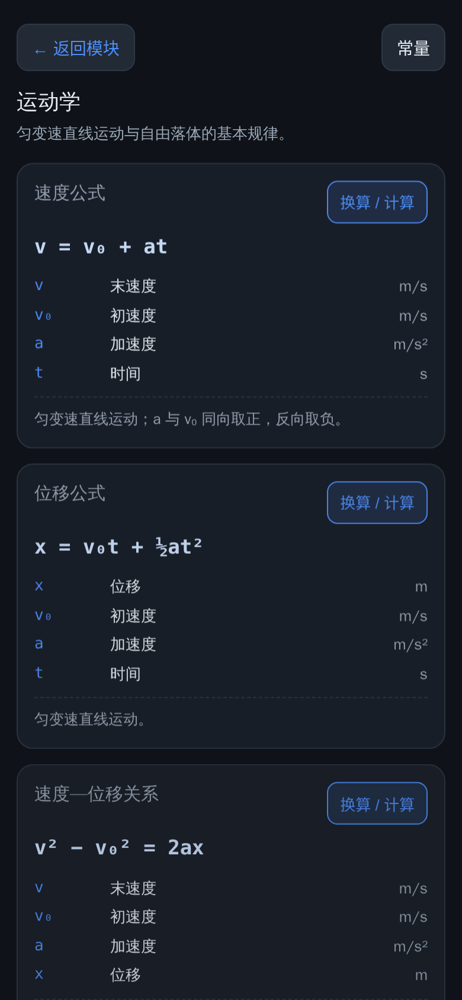
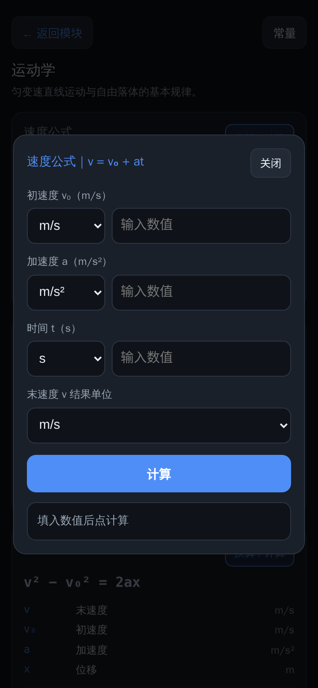
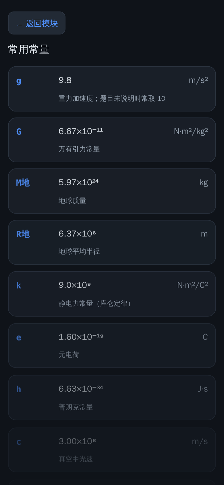

# 高中物理速算 · 手表 / 移动端学习工具

面向初高中学生的物理公式速查与速算工具：单文件响应式网页，深色小屏卡片布局；另含 iQOO WATCH GT1（BlueOS）快应用调试原型。纯本地运行，无网络请求、无广告、不收集隐私。

## 在线预览

https://xyt9527.github.io/watch-physics-tool/

## 作品预览

| 首页 · 章节模块 | 公式详情 · 符号与条件 |
| --- | --- |
|  |  |
| 计算 / 换算弹窗 | 常用常量 |
|  |  |

## 功能内容

- **17 个章节模块，88 条公式，9 个常用常量**
- 每条公式附带符号说明、单位与适用条件 / 模型注解
- 常用量支持代入计算，结果单位可在弹窗内换算
- 深色主题，针对窄屏 / 手表小屏做紧凑卡片排版

## 覆盖章节

运动学、相互作用、牛顿运动定律、曲线运动、万有引力与航天、功和能、动量、静电场、恒定电流、磁场、电磁感应、交变电流、机械振动、机械波、光、热学、原子物理。

## 技术栈

- 原生 HTML5 / CSS3 / JavaScript（无框架、无构建依赖）
- 快应用 `.ux` 页面原型（BlueOS / iQOO WATCH GT1，方形手表 390×450）
- Git + GitHub 版本管理

## 目录结构

```
├── index.html                        # GitHub Pages 入口（物理速算网页）
├── physics-mechanics-tool/           # 网页版源码与历史备份
├── iqoo-watch-gt1-app/               # BlueOS 快应用调试原型
└── docs/screenshots/                 # 作品预览截图
```

## 手表端原型说明

`iqoo-watch-gt1-app/` 为快应用（`.ux`）调试工程，需在 BlueOS Studio 中安装依赖并打包为 `.rpk`；当前在线预览为响应式网页版。

## 说明

个人学习练习作品，公式与计算结果请结合教材核对。
